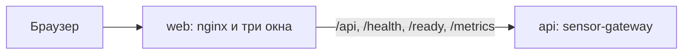

# Облачный DevOps-конвейер: демо-служба сенсорной платформы

Публичная база кейса. В репозитории три окна и один микросервис, которого достаточно, чтобы дальше собрать конвейер доставки. Расчёты, очереди, журнал эксперта и остальной контур платформы здесь не публикуются.

## Проблемы

Демо-сервис для проверки должен запускаться у другого человека с Ubuntu одной короткой командой. Сейчас проверяющему не на чем показать сборку образа, вход в приложение и живой ответ API. Полный продукт для этого слишком большой и содержит рабочий контур, который в этот репозиторий не входит.

## Работа

Сделано в этой базе:

- Лендинг продукта: главная страница с фрагментом поля, темой и переходом ко входу.
- Окно входа: логин и пароль, сессия в cookie.
- Окно «Служба»: после входа читает `GET /api/v1/service` и по кнопке вызывает `POST /api/v1/service/probe`.
- Микросервис `sensor-gateway` на FastAPI. Показание в окне синтетическое и помечено `note: synthetic`.
- `make up` поднимает nginx и API через Docker Compose.
- GitHub Actions: тесты API, сборка интерфейса, сборка двух образов и сканирование Trivy.

Дальше по кейсу 1, этого в репозитории ещё нет:

1. Инфраструктура как код: виртуальная машина или локальный стенд, k3s и сеть. Compose остаётся способом поднять демо. Кластер — следующий шаг, жюри допускает и k3s, и одноузловой стенд.
2. Публикация образа в registry по push. Сборка и Trivy уже в CI. Push в GHCR нужно добавить, когда появятся права на пакеты.
3. CD: Helm или Kustomize, blue-green или canary через ingress, откат при неудачном релизе.
4. Секреты через SOPS, Sealed Secrets или Vault и описанная ротация. Сейчас пароль стенда лежит в `.env`, файл не коммитится. Это осознанный промежуточный шаг, не финальная схема.
5. Prometheus и Grafana: минимум один дашборд и один алерт. Сервис уже отдаёт `/metrics` (`service_up`, `http_requests_total`, `service_probe_latency_seconds`). Стек мониторинга ещё не развёрнут.
6. Видео до 5 минут: показать работающий стенд, а не установку с нуля. Монтаж допустим. Сгенерированные кадры не использовать.

Кейс 2 (SRE: логи, SLO, хаос, самоисцеление, service mesh, eBPF) в эту базу не входит. Если команда берёт его отдельно, демо-службой можно оставить `sensor-gateway`: у неё есть здоровье, метрики и ручная проверка с задержкой.

## Команда

| Роль | Что делает в этом репозитории |
| --- | --- |
| Веб | Три окна: лендинг, вход, служба |
| DevOps | Конвейер, образы, кластер, секреты. В этой базе — Compose, CI и каркас сканирования |
| SRE | Метрики, дашборд, алерт. Пока подготовлен только `/metrics` |

Имена, опыт и навыки участников команда дописывает перед сдачей. Выдуманных биографий здесь нет.

## Архитектура



Браузер открывает `http://127.0.0.1:8080`. Nginx отдаёт собранный интерфейс и проксирует API. Cookie `dts_session` ставит API, она `HttpOnly` и `SameSite=Strict`. Окно «Служба» без сессии уходит на `/login`.

Маршруты интерфейса: `/`, `/login`, `/service`. Остальные адреса возвращают на главную.

## Инструменты

Версии, которыми собирается этот стенд:

| Инструмент | Версия |
| --- | --- |
| Python | 3.12 в образе `python:3.12-slim-bookworm` |
| FastAPI | 0.115.6 |
| Uvicorn | 0.34.0 |
| Node.js | 24 в образе `node:24-bookworm-slim` |
| Vite | 8 |
| React | 19 |
| nginx | 1.27-alpine |
| Docker Compose | файл `compose.yaml` |
| GitHub Actions | `ubuntu-24.04` |
| Trivy | `aquasecurity/trivy-action` 0.28.0, порог HIGH и CRITICAL |

Terraform, Ansible, k3s, Helm, Prometheus и Grafana в запуске этой базы не участвуют.

## Запуск

Проверяющие работают в Ubuntu. Нужны Git, Docker и Docker Compose.

Репозиторий приватный: жюри клонирует его под GitHub-аккаунтом, которому выдан доступ (HTTPS с токеном или SSH-ключ).

```bash
git clone https://github.com/Spar2/mts-devops-case.git
cd mts-devops-case
make up
```

`make` копирует `.env.example` в `.env`, если своего файла ещё нет, и выполняет `docker compose up --build -d`.

Открыть http://127.0.0.1:8080. Войти: логин `demo`, пароль `demo-stand-pass`. После входа открывается окно «Служба». Кнопка «Проверить службу» вызывает probe и показывает задержку.

Остановить: `make down`.

Локальные тесты без кластера: `make test`.

Пароль в `.env.example` — пароль локального стенда, не секрет продуктовой среды. Перед любой публикацией наружу его меняют в `.env` и перезапускают API. Файл `.env` в git не входит.

Ресурсы: два контейнера, ориентир до 2 ГБ RAM. Отдельная виртуальная машина не нужна.

## Наблюдаемость

Сейчас:

- `GET /health` и `GET /ready` отвечают `{"status":"ok"}`. Compose ждёт ready перед стартом web.
- `GET /metrics` отдаёт текст Prometheus. Счётчик `http_requests_total` растёт на каждом запросе, включая сам `/metrics`. `service_probe_latency_seconds` хранит последнюю проверку из окна «Служба».

Как проверить: после `make up` открыть http://127.0.0.1:8080/metrics.

Дашборда Grafana и алерта ещё нет. Их место — следующий слой, источник данных уже этот endpoint.

## Безопасность

- Пароль не зашит в образ интерфейса. API читает `DEMO_PASSWORD` из окружения. В репозитории есть только пример.
- Сессия: случайный токен, в памяти хранится SHA-256 токена, срок по умолчанию 12 часов. Перезапуск API сбрасывает сессии.
- Сравнение логина и пароля идёт по хешам одинаковой длины.
- На вход не больше 30 попыток в минуту с одного адреса. Дальше ответ 429.
- Вход короче 12 символов интерфейс не отправляет.

Ротация сейчас: сменить `DEMO_PASSWORD` в `.env` и выполнить `docker compose up -d --force-recreate api`. Старые cookie перестают подходить, потому что процесс и память сессий новые. Выкладка в SOPS или Sealed Secrets — следующий шаг кейса. Пока секрет лежит в dotenv, это нужно писать явно, а не выдавать за Vault.

## Использование LLM

В работе службы языковой модели нет. Генерации манифестов и разбора инцидентов тоже нет. Если документацию дальше будет править модель, в этот раздел нужно добавить промпт, что именно она сэкономила, и оставить человека, который может объяснить запуск контейнера.

## Troubleshooting

- `make: command not found` — поставить make или выполнить `cp .env.example .env` и `docker compose up --build -d`.
- Порт 8080 занят — остановить другой процесс или сменить проброс в `compose.yaml`.
- API не проходит healthcheck — в `.env` пароль короче 12 символов, процесс не стартует. В логах будет текст про `DEMO_PASSWORD`. Смотреть: `docker compose logs api`.
- Страница входа пишет, что сервер недоступен — web поднялся раньше ready или API перезапускается. Подождать и обновить. Готовность: `curl -fsS http://127.0.0.1:8080/ready`.
- После входа снова форма — cookie не сохранилась. Открывать именно `http://127.0.0.1:8080`, не файл с диска и не другой хост.
- Фрагмент на главной не загрузился — это статический `landing/visual-data.json`. Кнопка «Повторить» запрашивает его снова. Это не вызов API.
- Образ не собирается на старом Docker — нужен BuildKit и Compose V2, обычные для Ubuntu 24.04.

## Лицензия

MIT. Текст в файле `LICENSE`.
