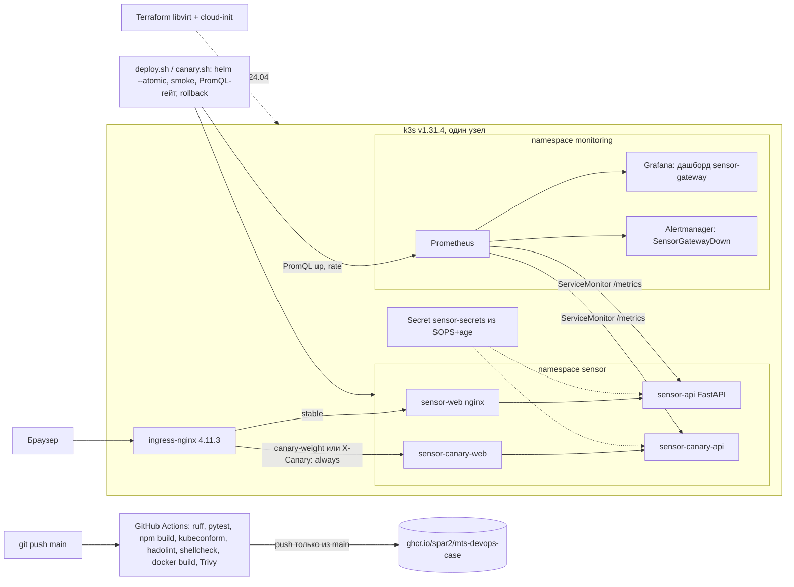

# Облачный DevOps-конвейер: от репозитория до production-Kubernetes за 3 команды

Кейс 1 хакатона МТС. Демо-служба `sensor-gateway` (FastAPI) и веб-интерфейс из трёх окон проходят путь:
push в `main` → линт, тесты, проверки манифестов, сборка, Trivy → образы в GHCR → Helm-релиз в k3s с canary
через ingress-nginx и автоматическим откатом по smoke и метрикам → дашборд и алерт в Prometheus/Grafana/Alertmanager.

## Проблема

Проверяющему нужно у себя на Ubuntu короткой командой поднять сервис и увидеть весь конвейер: сборку образа,
выкладку, откат неудачного релиза, секреты вне git и наблюдаемость. Полный продукт для этого слишком большой,
поэтому в репозитории одна служба и три окна (`/`, `/login`, `/service`). Расчёты, очереди, БД и остальной
контур платформы сюда сознательно не входят.

## Цель

Воспроизводимый конвейер из открытых инструментов с зафиксированными версиями, где каждое требование кейса
можно проверить командой и где есть лог реальной проверки.

### Требования кейса → реализация → проверка

| Требование | Где лежит | Как проверить | Статус проверки |
| --- | --- | --- | --- |
| Запуск ≤ 3 командами | `Makefile` (`make up`) | `git clone … && cd mts-devops-case && make up` | Проверено свежим клоном на box: вход, probe, 401 без cookie, `/metrics` |
| IaC: кластер | `scripts/k3s-install.sh`, `infra/ansible/site.yml` | `make k8s-up` / `ansible-playbook -i infra/ansible/inventory.ini infra/ansible/site.yml` | Проверено в режиме k3d (k3s v1.31.4) с чистого старта, лог `docs/k8s-up-log.md`; плейбук прогнан, `failed=0`. Нативный k3s на box не ставился (см. «Что не проверено») |
| IaC: ВМ | `infra/cloud-init/`, `infra/terraform/` (libvirt) | `terraform validate`, `cloud-init schema` | Валидация проходит. `terraform apply` на box не доведён (см. «Что не проверено») |
| CI: линт, тесты, сборка | `.github/workflows/ci.yml` | вкладка Actions | Зелёный прогон на GitHub (jobs lint, api, web, helm, manifests, dockerfiles, shellcheck, images) |
| Сканирование образов | там же, Trivy `v0.36.0`, HIGH/CRITICAL | Actions → images | Trivy нашёл реальные CVE (Starlette, OpenSSL в alpine), исправлено обновлением, прогон зелёный |
| Публикация в registry | там же, push в `ghcr.io/spar2/mts-devops-case/*` только из `main` | Actions → images → Push images | Шаг выполняется в зелёном прогоне |
| Проверка манифестов | job `manifests` (kubeconform 0.6.7), `dockerfiles` (hadolint), `shellcheck` | Actions | Зелёные; локально воспроизведено |
| CD: Helm + откат | `deploy/helm/sensor-gateway`, `scripts/deploy.sh` (`--atomic` + smoke + `helm rollback`) | `make k8s-rollback-demo` | Проверено: битый тег → откат `--atomic`; провал smoke → `helm rollback` (лог `docs/cd-demo-log.md`) |
| CD: canary через ingress | `scripts/canary.sh` (вес 10→50→100, smoke + Prometheus `up`/`rate`) | `make k8s-canary` | Проверено: успешный canary с promote и провальный canary с автооткатом, stable не задет (`docs/cd-demo-log.md`) |
| Сессии не теряются между stable и canary | подписанная cookie (HMAC) в `services/api/app/main.py` | тесты + запрос с cookie от stable в canary | Проверено: 200 на canary с cookie, выданной stable |
| Секреты вне git | SOPS 3.9.2 + age 1.2.1, `scripts/secrets-*.sh`, `deploy/secrets/README.md` | `scripts/secrets-rotate-check.sh` | Проверено: после ротации старый пароль и старая cookie → 401, новый пароль → 200 (`docs/secrets-rotation-log.md`) |
| Мониторинг: дашборд | `deploy/monitoring/` (kube-prometheus-stack 65.1.1) | Grafana → дашборд `sensor-gateway` | Проверено в k3d, скриншот `docs/img/grafana-sensor-gateway.png` |
| Мониторинг: алерт | `deploy/monitoring/prometheusrule.yaml` | `kubectl -n sensor scale deploy sensor-api --replicas=0` | Проверено: `SensorGatewayDown` firing в Prometheus и в Alertmanager (`docs/monitoring-alert-proof.md`, скриншоты) |
| Видео ≤ 5 мин | `docs/demo-script.md` | — | Сценарий готов, ролик снимает команда |

## Команда

| Роль | Что делает в этом репозитории |
| --- | --- |
| Веб | Три окна: лендинг, вход, служба |
| DevOps | Конвейер, образы, кластер, секреты: CI, Helm-чарт, k3s, canary, SOPS |
| SRE | Метрики, дашборд, алерт: kube-prometheus-stack, ServiceMonitor, PrometheusRule |

Имена, опыт и навыки участников команда дописывает перед сдачей. Выдуманных биографий здесь нет.

## Архитектура



- Compose-режим (`make up`): браузер → nginx `web` (127.0.0.1:8080) → `api:8000`. Nginx отдаёт интерфейс и
  проксирует `/api`, `/health`, `/ready`, `/metrics`.
- В Kubernetes nginx-конфиг web подменяется ConfigMap'ом чарта: каждый релиз проксирует в свой Service `<release>-api`.
- Сессия — подписанная cookie `dts_session` (HMAC-SHA256, `HttpOnly`, `SameSite=Strict`). Ключ выводится из
  `SESSION_SECRET` и `DEMO_PASSWORD`, поэтому stable и canary принимают одну cookie, а ротация пароля отзывает все сессии.

## Инструменты

| Инструмент | Версия |
| --- | --- |
| Python / FastAPI / Starlette / Uvicorn | 3.12 (`python:3.12-slim-bookworm`) / 0.143.3 / 1.8.0 / 0.34.0 |
| Node.js / Vite / React | 24 / 8 / 19 |
| nginx | 1.29-alpine + `apk upgrade` |
| Docker / Compose | Docker 24+ с BuildKit / Compose V2 (проверено 2.30.3) |
| k3s | v1.31.4+k3s1, traefik отключён |
| k3d (локальный режим) | v5.7.5 |
| Helm | v3.16.3 |
| ingress-nginx | чарт 4.11.3, https://kubernetes.github.io/ingress-nginx |
| kube-prometheus-stack | чарт 65.1.1, https://prometheus-community.github.io/helm-charts (Prometheus 2.54.1, Grafana 11.2.1, Alertmanager 0.27.0) |
| SOPS / age | 3.9.2 / 1.2.1 |
| Ansible | ansible-core 2.17 (проверено 2.17.5) |
| Terraform / провайдер | 1.9.8 / dmacvicar/libvirt 0.8.3 (`~> 0.8.1`) |
| cloud-init | схема проверена cloud-init 25.1 |
| GitHub Actions | `ubuntu-24.04`, ruff 0.8.4, `docker/build-push-action@v6`, `aquasecurity/trivy-action@v0.36.0`, kubeconform 0.6.7, `hadolint/hadolint-action@v3.1.0` |

Только открытые чарты из публичных репозиториев, версии зафиксированы.

### Ресурсы

| Режим | RAM | CPU | Диск |
| --- | --- | --- | --- |
| `make up` (Compose) | до 2 ГБ | 1–2 vCPU | ~1 ГБ образов |
| `make k8s-up` (k3s + мониторинг) | 8 ГБ рекомендуемо (стек занимает около 3 ГБ, лимит Prometheus 1 ГиБ), 16 ГБ с запасом | 2–4 vCPU | ~10 ГБ |
| ВМ из `infra/terraform` | 8 ГиБ по умолчанию (`vm_memory_mib`) | 4 vCPU | 30 ГиБ |

## Как запустить

Проверяющие работают в Ubuntu. Нужны Git, Docker с Compose V2 и `make`; для `make k8s-up` ещё `sudo` и `curl`.

Репозиторий приватный: жюри клонирует его под GitHub-аккаунтом, которому выдан доступ (HTTPS с токеном или SSH-ключ).

```bash
git clone https://github.com/Spar2/mts-devops-case.git
cd mts-devops-case
make up
```

Открыть http://127.0.0.1:8080, логин `demo`, пароль `demo-stand-pass` (из `.env.example`, пароль локального стенда).
Остановить: `make down`.

**Почему `make up` — Compose.** Эксперты допустили Compose. Установка Prometheus в кластер занимает минуты, а три команды
должны давать работающий стенд быстро и предсказуемо. Полный Kubernetes-контур — отдельной целью:

```bash
make k8s-up            # k3s + ingress-nginx (ждёт admission webhook) + SOPS-секрет + kube-prometheus-stack + Helm-релиз + smoke
make k8s-canary        # canary 10 → 50 → 100 с smoke и PromQL-гейтом на каждом шаге, затем promote
./scripts/canary-fail-demo.sh <tag>   # заведомо неверный секрет у canary → автоматический откат, stable не задет
make k8s-rollback-demo # битый тег образа → helm --atomic откатывает релиз, печатается helm history
INGRESS_PORT=80 ./scripts/secrets-rotate-check.sh   # ротация пароля end-to-end
make k8s-down
```

- Приложение: http://sensor.localtest.me (имя резолвится в 127.0.0.1). Пароль печатает `scripts/secrets-init.sh`
  при первом запуске, он же лежит в Secret `sensor-secrets`.
- Grafana: http://grafana.localtest.me (демо-доступ admin/admin — поменять перед публикацией).
- Prometheus и Alertmanager: `kubectl -n monitoring port-forward svc/mon-kube-prometheus-stack-prometheus 9090:9090`
  и `svc/mon-kube-prometheus-stack-alertmanager 9093:9093`.
- `make k8s-up` собирает образы локально и импортирует их в containerd k3s: доступ к приватным пакетам GHCR не нужен.
  Образы из CI: `make k8s-deploy TAG=<sha>` при настроенном imagePullSecret.
- Без sudo, в Docker: `make k8s-up K3D=1` (кластер k3d `mts`, ingress на `:8081`).
- Ansible: `ansible-playbook -i infra/ansible/inventory.ini infra/ansible/site.yml` — обёртка над `make k8s-up`.
- ВМ: `infra/README.md` (Terraform + cloud-init, внутри ВМ выполняется `make k8s-up`).

### Как работает CD

- `scripts/deploy.sh TAG` — `helm upgrade --install --atomic --wait --timeout 3m`; если поды не стали ready, Helm откатывает
  релиз сам. Затем `scripts/smoke.sh` (`/ready`, `/metrics`, 401 без cookie, вход, `/api/v1/service`, probe); при провале
  `helm rollback sensor 0`.
- `scripts/canary.sh TAG` — релиз `sensor-canary` с аннотациями ingress-nginx `canary`, `canary-weight`, `canary-by-header: X-Canary`.
  На каждом шаге: smoke через `X-Canary: always`, нагрузка, затем PromQL: `min(up{service="sensor-canary-api"}) == 1` и
  `sum(rate(http_requests_total{service="sensor-canary-api"}[2m])) > 0`. Любой провал → вес 0, удаление canary, `ROLLBACK canary: <причина>`.
  Успех → promote в stable через `deploy.sh`, удаление canary.
- Stable smoke во время canary шлёт `X-Canary: never`, чтобы проверять именно stable.

## Мониторинг

- Сервис отдаёт `/health`, `/ready`, `/metrics` (`service_up`, `http_requests_total`, `service_probe_latency_seconds`).
- ServiceMonitor из чарта (label `release: mon`) подключает `/metrics` stable и canary к Prometheus.
- Дашборд Grafana `sensor-gateway` (`deploy/monitoring/dashboard-configmap.yaml`): service_up, rate запросов, задержка probe, `up` таргета.

  

- Алерты (`deploy/monitoring/prometheusrule.yaml`): `SensorGatewayDown` — нет ни одного живого таргета API 1 минуту (critical);
  `SensorGatewaySlowProbe` — probe дольше 0.5 с 5 минут (warning). Почему `up`, а не `service_up`: `service_up` отдаёт сам
  процесс, и при падении пода метрика просто исчезает; `up` выставляет Prometheus, а `or vector(0)` ловит и исчезновение ряда.
- Проверено: после `scale --replicas=0` алерт стал pending через ~80 с и firing через ~140 с, Alertmanager его получил
  (`docs/monitoring-alert-proof.md`, `docs/img/prometheus-alert-firing.png`, `docs/img/alertmanager-alert.png`).
  Receiver в демо `null`: доставка в почту или мессенджер не настраивалась.
- Скриншот дашборда снимается `scripts/grafana-screenshot.py` (Playwright + headless Chrome).

## Безопасность

- Compose: `DEMO_PASSWORD` из `.env` (не в git), пример — `.env.example`.
- Kubernetes: Secret `sensor-secrets` (`DEMO_PASSWORD`, `SESSION_SECRET`) зашифрован SOPS на ключ age. Приватный ключ —
  `~/.config/sops/age/keys.txt`, конфиг SOPS с публичным ключом — нетрекаемый `deploy/secrets/sops.local.yaml`.
  Трекаемые файлы скрипты не меняют. Ротация пароля, ключа сессий и ключа age — `deploy/secrets/README.md`.
- Сессия: подписанная cookie с истечением (12 ч), сравнение подписи за постоянное время; ротация пароля отзывает все сессии.
  Logout стирает cookie в браузере; сама подпись действительна до истечения или ротации — это осознанный компромисс stateless-сессий.
- Вход: не больше 30 попыток в минуту с адреса (429).
- CI: Trivy блокирует образ с исправимыми HIGH/CRITICAL; push в GHCR только из `main`; `GITHUB_TOKEN` с `contents: read`, `packages: write`.
- Кластер: API запускается не от root, у всех подов requests/limits.
- Cloud-init: GitHub-токен для приватного репо передаётся через Terraform (`sensitive`) и удаляется после клонирования.

## Использование LLM

В работе службы языковой модели нет. LLM использовалась только при разработке.

- **Инструмент:** Grok CLI v1.0.52, модель `grok-4.7-build-fast`. Две волны параллельных сессий (5 + 4), у каждой свои
  каталоги, git-команды сессиям запрещены. Ревью, интеграция, прогоны в k3d и коммиты — человек.
- **Промпты** дословно — `docs/llm/prompts.md`.
- **Экономия:** по субъективной оценке около 10 ч ручной работы против ~3 ч (генерация + ревью + исправления).
  Хронометраж не вёлся.
- **Ошибки модели, найденные проверкой:** canary Ingress без `canary-by-header`, окно `rate[1m]` при scrape 30 с,
  smoke не принимал формат подписанной cookie, Ansible в обход SOPS, секрет применялся без перезапуска подов.
  Все найдены реальными прогонами в кластере, а не чтением кода, — поэтому все критичные пути имеют логи в `docs/`.
- **Риски внешнего API:** в промпты уходил только код этого репозитория, без секретов и ключей (пароль стенда —
  демонстрационный). Сборка, CI и запуск от LLM не зависят: если API недоступен, ничего не ломается.
- **Как проверить без ключа LLM:** ключ не нужен вообще — все проверки воспроизводятся командами из раздела «Как запустить»,
  CI и логами в `docs/`.
- **Понимание кода командой:** каждый сгенерированный файл прошёл ревью; что делает каждый скрипт, описано в README и
  в шапках скриптов; исправления выше сделаны вручную после разбора причин.

## Видео

Требования: до 5 минут, показать работающий стенд, а не установку с нуля; склейка и монтаж допустимы; сгенерированные кадры
не использовать. Пошаговый сценарий с таймингом — `docs/demo-script.md`. Ролик снимает команда.

## Что не проверено и ограничения

- **Нативный k3s на Ubuntu** (`make k8s-up` без `K3D=1`) на box не запускался: в песочнице нет systemd и vxlan.
  Тот же скрипт и те же чарты проверены в k3d с образом k3s v1.31.4. Для песочницы понадобились параметры
  `K3D_PRELOAD=1` (из подов нет egress), `INGRESS_SERVICE_TYPE=NodePort` (не работает hostPort) и host-gw вместо vxlan —
  на обычной Ubuntu они не нужны.
- **`terraform apply`** на box не доведён: вложенная ВМ на 6 ГБ исчерпала память песочницы. Проверены `terraform validate`
  и `cloud-init schema`; внутри ВМ выполняется тот же `make k8s-up`, что проверен выше.
- Доставка алертов во внешний канал не настраивалась (receiver `null`).

## Troubleshooting

- `make: command not found` — `sudo apt-get install -y make` или `cp .env.example .env && docker compose up --build -d`.
- Порт 8080 занят — остановить другой процесс или сменить проброс в `compose.yaml`.
- API не проходит healthcheck — в `.env` пароль короче 12 символов: `docker compose logs api`.
- После входа снова форма — открывать именно `http://127.0.0.1:8080`, не файл и не другой хост.
- Образ не собирается — нужен BuildKit и Compose V2 (есть в Ubuntu 24.04).
- `make k8s-up` падает на установке k3s — нужен sudo и доступ к get.k3s.io; повторный запуск идемпотентен.
- Поды в `ImagePullBackOff` — образы приложения не импортированы: `make k8s-images`; при закрытом egress — `K3D_PRELOAD=1`.
- `sensor.localtest.me` не открывается — DNS не отдаёт 127.0.0.1: добавить `127.0.0.1 sensor.localtest.me grafana.localtest.me` в `/etc/hosts`.
- Smoke падает на входе после смены секрета — Secret читается подами при старте; `scripts/secrets-apply.sh` сам делает `rollout restart`.
- `Ключ age этой машины не совпадает с получателем` — файл зашифрован другим ключом: удалить `deploy/secrets/sensor-secrets.enc.yaml`
  и запустить `scripts/secrets-init.sh` заново (будет новый пароль).
- Canary откатился с `prometheus returned no sample` — Prometheus ещё не снял две точки: увеличить `ANALYSIS_WAIT_S`.
- `make k8s-canary` пишет `WARN` про Prometheus — нет port-forward на 9090; гейт работает только по smoke.

## Лицензия

MIT. Текст в файле `LICENSE`.
