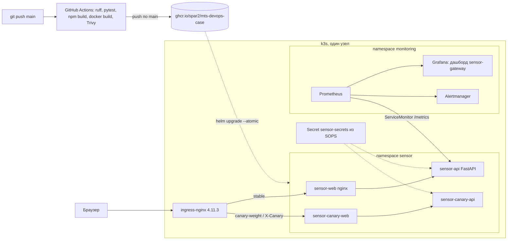

# Облачный DevOps-конвейер: от репозитория до production-Kubernetes за 3 команды

Кейс 1 хакатона МТС. Демо-служба `sensor-gateway` (FastAPI) и веб-интерфейс из трёх окон
проходят путь: push в `main` → линт, тесты, сборка, Trivy → образы в GHCR → Helm-релиз в k3s
с canary через ingress-nginx и автоматическим откатом → метрики, дашборд и алерт в Prometheus/Grafana.

## Проблема

Проверяющему нужно у себя на Ubuntu короткой командой поднять сервис и увидеть весь конвейер:
сборку образа, выкладку, откат при неудачном релизе, секреты вне git и наблюдаемость.
Полный продукт для этого слишком большой, поэтому в репозитории только одна служба и три окна.
Расчёты, очереди, БД и остальной контур платформы сюда сознательно не входят.

## Цель

1. Инфраструктура как код: k3s ставится скриптом или Ansible-плейбуком.
2. CI: ruff, pytest, сборка интерфейса, сборка образов, Trivy, push в `ghcr.io/spar2/mts-devops-case/*` по push в `main`.
3. CD: Helm-чарт, canary через ingress-nginx, `helm --atomic` + smoke-check с `helm rollback`.
4. Секреты: SOPS + age, описанная ротация.
5. Мониторинг: kube-prometheus-stack, дашборд `sensor-gateway` и алерты.
6. Видео до 5 минут (требования ниже).

## Команда

| Роль | Что делает в этом репозитории |
| --- | --- |
| Веб | Три окна: лендинг, вход, служба |
| DevOps | Конвейер, образы, кластер, секреты: CI, Helm-чарт, k3s, canary, SOPS |
| SRE | Метрики, дашборд, алерт: kube-prometheus-stack, ServiceMonitor, PrometheusRule |

Имена, опыт и навыки участников команда дописывает перед сдачей. Выдуманных биографий здесь нет.

## Архитектура



Compose-режим проще: браузер → nginx (`web`, порт 8080) → `api:8000`. Nginx отдаёт интерфейс и
проксирует `/api`, `/health`, `/ready`, `/metrics`. Cookie `dts_session` ставит API (`HttpOnly`, `SameSite=Strict`).
Маршруты интерфейса: `/`, `/login`, `/service`.

В Kubernetes nginx-конфиг web подменяется ConfigMap'ом чарта: каждый релиз (stable и canary) проксирует
в свой Service `<release>-api`.

## Инструменты

| Инструмент | Версия |
| --- | --- |
| Python / FastAPI / Uvicorn | 3.12 (`python:3.12-slim-bookworm`) / 0.115.6 / 0.34.0 |
| Node.js / Vite / React | 24 / 8 / 19 |
| nginx | 1.27-alpine |
| Docker Compose | V2 (проверено на 2.30.3) |
| GitHub Actions | `ubuntu-24.04`, ruff 0.8.4, `docker/build-push-action@v6`, `aquasecurity/trivy-action@v0.36.0` (HIGH, CRITICAL) |
| k3s | v1.31.4+k3s1, traefik отключён (локально проверено в k3d v5.7.5) |
| Helm | v3.16.3 |
| ingress-nginx | чарт 4.11.3 (https://kubernetes.github.io/ingress-nginx) |
| kube-prometheus-stack | чарт 65.1.1 (https://prometheus-community.github.io/helm-charts) |
| SOPS / age | 3.9.2 / 1.2.1 |
| Ansible | любой 2.15+ (плейбук `infra/ansible/site.yml`) |

Все чарты открытые, из публичных репозиториев, версии зафиксированы.

## Запуск

Проверяющие работают в Ubuntu. Нужны Git, Docker и Docker Compose V2, для `make k8s-up` ещё sudo и `curl`.

Репозиторий приватный: жюри клонирует его под GitHub-аккаунтом, которому выдан доступ (HTTPS с токеном или SSH-ключ).

```bash
git clone https://github.com/Spar2/mts-devops-case.git
cd mts-devops-case
make up
```

Почему `make up` — это Compose, а не Kubernetes: эксперты на созвоне допустили Compose, а установка
Prometheus в кластер занимает около 8 минут. Три команды должны давать работающий стенд быстро и
предсказуемо. Полный Kubernetes-контур — отдельной целью:

```bash
make k8s-up            # k3s + ingress-nginx + SOPS-секрет + kube-prometheus-stack + Helm-релиз, ~10 мин
make k8s-canary        # canary 10% → 50% с smoke на каждом шаге, затем promote
make k8s-rollback-demo # заведомо битый тег: helm --atomic откатывает релиз, печатается helm history
make k8s-down
```

Compose: открыть http://127.0.0.1:8080, логин `demo`, пароль `demo-stand-pass` (из `.env.example`).
Kubernetes: http://sensor.localtest.me (имя резолвится в 127.0.0.1), пароль печатает `scripts/secrets-init.sh`,
Grafana — http://grafana.localtest.me.

`make k8s-up` собирает образы локально и импортирует их в containerd k3s, поэтому не нужен доступ к приватным
пакетам GHCR. Образы, которые пушит CI, используются так: `make k8s-deploy TAG=<sha>` при настроенном pull secret.

Ресурсы: Compose — два контейнера, до 2 ГБ RAM. Kubernetes-контур — ориентир 6–8 ГБ RAM, 2+ vCPU.

Локальные тесты: `make test`, линт: `make lint`. Остановить Compose: `make down`.

### CD: как работает откат

- `scripts/deploy.sh TAG` — `helm upgrade --install --atomic --wait --timeout 3m`. Если поды не стали ready,
  Helm сам откатывает релиз.
- После выкладки `scripts/smoke.sh`: `/ready` 200, `/metrics` содержит `service_up 1`, `/api/v1/service` без cookie 401,
  вход, `/api/v1/service` с cookie 200, probe 200. При провале — `helm rollback sensor 0` и выход с ошибкой.
- `scripts/canary.sh TAG` — второй релиз `sensor-canary` с аннотациями `nginx.ingress.kubernetes.io/canary`,
  `canary-weight` и `canary-by-header: X-Canary`. На каждом шаге веса smoke идёт с `X-Canary: always`.
  Успех — promote в stable и удаление canary, провал — удаление canary.

## Мониторинг

- `/health`, `/ready`, `/metrics` (`service_up`, `http_requests_total`, `service_probe_latency_seconds`).
- В кластере ServiceMonitor из чарта (label `release: mon`) подключает `/metrics` к Prometheus.
- Дашборд Grafana `sensor-gateway` (`deploy/monitoring/dashboard-configmap.yaml`): service_up, rate запросов,
  задержка probe, `up` таргета.
- Алерты (`deploy/monitoring/prometheusrule.yaml`): `SensorGatewayDown` (нет ни одного живого таргета API 1 мин, critical)
  и `SensorGatewaySlowProbe` (probe > 0.5 с 5 мин, warning). Выбор метрики: `up` от Prometheus ловит и падение
  процесса, и пропажу пода, чего `service_up` сам по себе не покажет — он всегда 1, пока процесс жив.
- Проверить алерт: `kubectl -n sensor scale deploy sensor-api --replicas=0`, через ~1–2 мин алерт в Prometheus `/alerts`.
- Подробнее: `deploy/monitoring/README.md`.

## Безопасность

- Compose: `DEMO_PASSWORD` из `.env` (не в git), пример — `.env.example`. Это пароль локального стенда.
- Kubernetes: Secret `sensor-secrets` хранится зашифрованным SOPS (age). `scripts/secrets-init.sh` генерирует ключ
  age в `~/.config/sops/age/keys.txt` (в git не попадает) и зашифрованный `deploy/secrets/sensor-secrets.enc.yaml`.
  У стенда жюри свой ключ, поэтому этот файл в `.gitignore`; в рабочей среде команда коммитит файл, зашифрованный
  на ключи команды.
- Ротация пароля: `scripts/secrets-rotate.sh` — новый пароль, `sops set`, apply, `rollout restart` API.
  Ротация ключа age и порядок действий — `deploy/secrets/README.md`.
- Сессия: случайный токен, в памяти SHA-256, срок 12 ч; вход не чаще 30 попыток в минуту с адреса (429).
- CI: Trivy блокирует образ с HIGH/CRITICAL (кроме unfixed); push в GHCR только из `main`, `GITHUB_TOKEN` с `packages: write`.
- API в кластере запускается не от root, с лимитами ресурсов.

## Использование LLM

В работе службы языковой модели нет. Код конвейера (Helm-чарт, CI, CD-скрипты, SOPS, мониторинг) написан
пятью параллельными сессиями Grok CLI (`grok-4.7-build-fast`), каждая в своих каталогах. Ревью, интеграция,
прогон в k3d и исправления — вручную. Промпты, оценка экономии времени (~7 ч → ~1.5 ч) и список ошибок модели,
найденных при проверке: `docs/llm/prompts.md`.

## Видео (требования, ролик снимает команда)

- До 5 минут, показывать работающий стенд, а не установку с нуля. Склейка и монтаж допустимы.
- Сгенерированные кадры не использовать.
- Что показать: push → Actions, вход и probe, canary и откат (`make k8s-rollback-demo`), дашборд и срабатывание алерта.

## Troubleshooting

- `make: command not found` — поставить make или выполнить `cp .env.example .env` и `docker compose up --build -d`.
- Порт 8080 занят — остановить другой процесс или сменить проброс в `compose.yaml`.
- API не проходит healthcheck — в `.env` пароль короче 12 символов, процесс не стартует. В логах будет текст про `DEMO_PASSWORD`. Смотреть: `docker compose logs api`.
- Страница входа пишет, что сервер недоступен — web поднялся раньше ready или API перезапускается. Подождать и обновить. Готовность: `curl -fsS http://127.0.0.1:8080/ready`.
- После входа снова форма — cookie не сохранилась. Открывать именно `http://127.0.0.1:8080`, не файл с диска и не другой хост.
- Фрагмент на главной не загрузился — это статический `landing/visual-data.json`. Кнопка «Повторить» запрашивает его снова. Это не вызов API.
- Образ не собирается на старом Docker — нужен BuildKit и Compose V2, обычные для Ubuntu 24.04.

- `make k8s-up` падает на установке k3s — нужен sudo и доступ к get.k3s.io. Повторный запуск идемпотентен.
- Поды в `ImagePullBackOff` — образы не импортированы: `make k8s-images`.
- `sensor.localtest.me` не открывается — DNS не отдаёт 127.0.0.1: добавить `127.0.0.1 sensor.localtest.me grafana.localtest.me` в `/etc/hosts`.
- `failed calling webhook validate.nginx.ingress.kubernetes.io` — admission webhook ingress-nginx ещё не готов; подождать минуту и повторить `make k8s-deploy`.
- Во время canary с весом пользователя «выкидывает» на вход — сессии в памяти процесса, stable и canary их не делят. Для smoke используется заголовок `X-Canary`.
- Секрет не расшифровывается — нет ключа age в `~/.config/sops/age/keys.txt`; на новом стенде заново выполнить `scripts/secrets-init.sh`.

## Лицензия

MIT. Текст в файле `LICENSE`.
