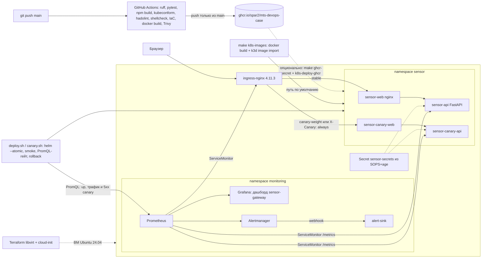
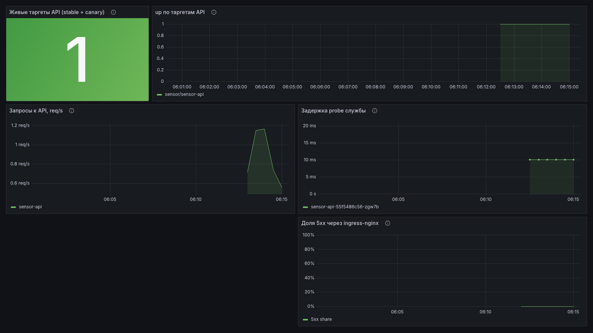

# Облачный DevOps-конвейер: от репозитория до production-Kubernetes за 3 команды

## Название кейса

Кейс 1 хакатона МТС «Облачный DevOps-конвейер: от репозитория до production-Kubernetes за 3 команды».

Демо-служба `sensor-gateway` (FastAPI) и веб-интерфейс из трёх окон.

Что есть на самом деле:

- **CI (GitHub Actions, `ci.yml`).** На каждый push и pull request: линт, тесты, проверки манифестов, IaC (Terraform, Ansible, cloud-init, Trivy config), сборка, Trivy образов. Локально без сборки образов: `make lint` и `make test` (раздел «CI локально»; job `iac` и `images` в них не входят). Только на `main`: SBOM и push образов в приватный GHCR.
- **CD.** Выкладка в кластер идёт командами `make up`, `make k8s-deploy` и `make k8s-canary`: Helm `--atomic`, smoke, canary через ingress-nginx с PromQL-гейтом и автооткатом. По умолчанию образы собираются локально из того же коммита.
- **e2e в Actions (`e2e.yml`).** На pull request в `main` (кроме правок только `*.md`/`docs/`) прогоняется только k3d. На push в `main` с тем же фильтром и вручную через `workflow_dispatch` — оба варианта, k3d и нативный k3s. Устаревший прогон того же PR отменяется; прогон `main` не прерывается. Секретов workflow не использует, образы собираются на раннере.
- **Без CD-деплоя из Actions.** Отдельного деплоя в постоянный кластер из Actions нет: у проекта нет постоянного кластера, доступного GitHub.

## Описание проблемы

Проверяющему нужно у себя на Ubuntu короткой командой поднять сервис и увидеть весь конвейер: сборку образа,
выкладку, откат неудачного релиза, секреты вне git и наблюдаемость. Полный продукт для этого слишком большой,
поэтому в репозитории одна служба и три окна (`/`, `/login`, `/service`). Расчёты, очереди, БД и остальной
контур платформы сюда сознательно не входят.

## Цель работы

Воспроизводимый конвейер из открытых инструментов с зафиксированными версиями, где каждое требование кейса
можно проверить командой и где есть лог реальной проверки.

### Требования кейса → реализация → проверка

| Требование | Где лежит | Как проверить | Статус проверки |
| --- | --- | --- | --- |
| Запуск ≤ 3 командами | `Makefile` (`make up`) | `git clone … && cd mts-devops-case && make up` | Проверено: свежий клон e0fe907 на box без кластера, `make up` за 2 мин 0 с (smoke: вход, probe, 401 без cookie, `/metrics`); повторный `make k8s-up K3D=1` идемпотентен (1 мин 11 с). Тот же путь — в e2e GitHub Actions: k3d на pull request в `main`, k3d и нативный k3s на push в `main` и по `workflow_dispatch` |
| IaC: кластер | `scripts/k3s-install.sh`, `infra/ansible/site.yml` | `make k8s-up` / `ansible-playbook -i infra/ansible/inventory.ini infra/ansible/site.yml` | k3d: свежий клон на box и e2e; нативный k3s (`make up K3D=0`): только e2e на `ubuntu-24.04`. Лог `docs/k8s-up-log.md`; плейбук прогонялся раньше, `failed=0`. syntax-check — job `iac` (ansible-core 2.17.14) |
| IaC: ВМ | `infra/cloud-init/`, `infra/terraform/` (libvirt, lock 0.8.3) | job `iac`: `terraform fmt -check`, `init -backend=false`, `validate`; `cloud-init schema` | Локально: Terraform 1.9.8, cloud-init 26.1, схемы `Valid`. `terraform apply` на box не доведён (см. «Что не проверено») |
| CI: линт, тесты, сборка | `.github/workflows/ci.yml` | вкладка Actions | Зелёный прогон на GitHub (jobs lint, api, web, helm, manifests, dockerfiles, shellcheck, llm, iac, images). Job `iac` зелёный на GitHub (pull request #3) и воспроизведён локально |
| Сканирование образов | job `images` и job `iac` (config: чарт, Dockerfile, Terraform), `trivy-action` v0.36.0 (Trivy v0.70.0), HIGH/CRITICAL; SBOM (anchore/sbom-action) на `main` | Actions → images и iac | Образы: CVE (Starlette, OpenSSL в alpine) исправлены, прогон зелёный. Config: локально Trivy 0.70.0, чарт и Terraform без HIGH/CRITICAL; DS-0002 nginx-образа — `apps/web/.trivyignore` |
| Публикация в registry | там же, push в `ghcr.io/spar2/mts-devops-case/*` только из `main` | Actions → images → Push images | Шаг выполняется в зелёном прогоне |
| Проверка манифестов | `scripts/lint-manifests.sh` (kubeconform 0.6.7: stable, canary, два манифеста мониторинга), hadolint 2.12.0, shellcheck 0.10.0 | `make lint` | Проверено локально: `make lint` код 0. Сломанный YAML и скрипт с ошибкой shellcheck дают ненулевой код (правки откачены). Job `manifests` вызывает тот же скрипт |
| CD: Helm + откат | `deploy/helm/sensor-gateway` (RollingUpdate `maxUnavailable: 0`, `preStop`), `scripts/deploy.sh` (`--atomic` + smoke + `helm rollback`) | `make k8s-rollback-demo` | Проверено: битый тег → откат `--atomic`; провал smoke → `helm rollback` (лог `docs/cd-demo-log.md`). Живой rollout после `preStop` не повторялся |
| CD: canary через ingress | `scripts/canary.sh` (вес 10→50→100, smoke + PromQL: `up`, трафик и доля 5xx canary по метрикам ingress-nginx) | `make k8s-canary` | Проверено: успешный canary с promote и провальный canary с автооткатом, stable не задет (`docs/cd-demo-log.md`) |
| Сессии не теряются между stable и canary | подписанная cookie (HMAC) в `services/api/app/main.py` | тесты + запрос с cookie от stable в canary | Проверено: 200 на canary с cookie, выданной stable |
| Секреты вне git | SOPS 3.9.2 + age 1.2.1, `scripts/secrets-*.sh`, `deploy/secrets/README.md` | `scripts/secrets-rotate-check.sh` | Лог 2026-10-17: старый пароль и cookie → 401, новый → 200 (`docs/secrets-rotation-log.md`). Позже на 1 реплике без паузы перед SIGTERM тот же скрипт получил 502; после `preStop` прогон не повторялся |
| Мониторинг: дашборд | `deploy/monitoring/` (kube-prometheus-stack 65.1.1) | Grafana → дашборд `sensor-gateway` | Проверено в k3d, скриншот `docs/img/grafana-sensor-gateway.png` |
| Мониторинг: алерт | `deploy/monitoring/prometheusrule.yaml` | `kubectl -n sensor scale deploy sensor-api --replicas=0` | Проверено: `SensorGatewayDown` firing в Prometheus и в Alertmanager (`docs/monitoring-alert-proof.md`, скриншоты) |
| Сеть ВМ (netplan) | `infra/cloud-init/network-config.yaml` → `libvirt_cloudinit_disk.network_config` | `cloud-init schema` (job `iac`) | Схема валидна (cloud-init 26.1); ВМ не поднималась |
| Безопасность подов | securityContext, NetworkPolicy, PDB в чарте | `make k8s-netpol-check` | NetworkPolicy проверена в e2e на GitHub (чужой namespace → BLOCKED, web → API → REACHED) |
| Доставка алерта | Alertmanager → webhook `alert-sink` | `make k8s-alert-demo` | Проверено: firing → webhook → resolved (e2e и box) |
| LLM: генерация конфигов с фиксацией промтов | `llm/`, `scripts/llm-*.sh`, `docs/llm/` | `make llm-up && make llm-gen`, `make llm-test` | Проверено на box: 3 правила, 2 приняты валидатором, 1 отвергнут promtool; job `llm` в CI |
| Видео ≤ 5 мин | `docs/demo-script.md` | — | Сценарий готов, ролик снимает команда |

## Состав команды (роли, опыт и навыки)

| Роль | Зона ответственности в репозитории | Навыки, которые применены в решении |
| --- | --- | --- |
| Веб | Три окна: лендинг, вход, служба (`apps/web`) | React 19, Vite 8, nginx |
| DevOps | CI, образы, Helm-чарт, k3s/k3d, canary, SOPS, IaC (`.github/`, `deploy/`, `scripts/`, `infra/`) | GitHub Actions, Docker/BuildKit, Trivy, Helm, Kubernetes, ingress-nginx, SOPS/age, Ansible, Terraform, cloud-init |
| SRE | Метрики, дашборд, алерт, доставка алерта (`deploy/monitoring/`) | Prometheus/PromQL, Grafana, Alertmanager, kube-prometheus-stack |

Имена и личный опыт участников команда указывает сама при сдаче; выдуманных биографий в репозитории нет.

## Архитектура/схема



- Compose-режим (`make demo`): браузер → nginx `web` (127.0.0.1:8080) → `api:8000`. Nginx отдаёт интерфейс и
  проксирует `/api`, `/health`, `/ready`, `/metrics`.
- В Kubernetes nginx-конфиг web подменяется ConfigMap'ом чарта: каждый релиз проксирует в свой Service `<release>-api`.
- Сессия — подписанная cookie `dts_session` (HMAC-SHA256, `HttpOnly`, `SameSite=Strict`). Ключ выводится из
  `SESSION_SECRET` и `DEMO_PASSWORD`, поэтому stable и canary принимают одну cookie, а ротация пароля отзывает все сессии.

## Использованные инструменты с версиями

| Инструмент | Версия |
| --- | --- |
| Python / FastAPI / Starlette / Uvicorn | 3.12 (`python:3.12-slim-bookworm`) / 0.143.3 / 1.8.0 / 0.34.0 |
| Node.js / Vite / React | 24 (`node:24-bookworm-slim`) / 8.3.4 / 19.3.1 (из `package-lock.json`) |
| nginx | 1.29-alpine + `apk upgrade` |
| Docker / Compose | Docker 24+ с BuildKit / Compose V2 (проверено 2.30.3) |
| k3s | v1.31.4+k3s1, traefik отключён |
| k3d (режим по умолчанию) | v5.8.3 |
| kubectl | v1.31.4 |
| Helm | v3.16.3 |
| ingress-nginx | чарт 4.11.3, https://kubernetes.github.io/ingress-nginx. Проект объявлен архивным 2026-03-24, версия зафиксирована и работает; на замену стоит смотреть Gateway API |
| kube-prometheus-stack | чарт 65.1.1, https://prometheus-community.github.io/helm-charts (Prometheus 2.54.1, Grafana 11.2.1, Alertmanager 0.27.0) |
| SOPS / age | 3.9.2 / 1.2.1 |
| Ansible | ansible-core 2.17.14 (syntax-check в CI; полный прогон плейбука раньше на 2.17.5, `failed=0`) |
| Terraform / провайдер | 1.9.8 / dmacvicar/libvirt 0.8.3. Lock-файл `infra/terraform/.terraform.lock.hcl` (в `versions.tf`: `>= 1.6`, `~> 0.8.1`) |
| cloud-init | 26.1 (в CI — пакет из архива ubuntu-24.04, версия печатается в лог) (схема примера рендера и network-config; раньше также 25.1). `user-data.yaml.tftpl` — шаблон Terraform, в схему не подаётся |
| Локальная LLM (опц.) | llama.cpp server `b11681`, модель Ternary-Bonsai-2-4B Q2_0 (Apache-2.0), promtool из `prom/prometheus:v2.54.1` |
| GitHub Actions | `ubuntu-24.04`, ruff 0.8.4, `docker/build-push-action@v6`, `aquasecurity/trivy-action@v0.36.0` (Trivy v0.70.0, образы и config), `hashicorp/setup-terraform@v4.0.1` (Terraform 1.9.8), ansible-core 2.17.14, cloud-init (пакет ubuntu-24.04), `anchore/sbom-action@v0.17.8`, kubeconform 0.6.7, hadolint 2.12.0 (`hadolint/hadolint-action@v3.1.0`, порог error), shellcheck 0.10.0 |
| Приёмник алертов | `mendhak/http-https-echo:34` |

Только открытые чарты из публичных репозиториев, версии зафиксированы.

### Ресурсы

| Режим | RAM | CPU | Диск |
| --- | --- | --- | --- |
| `make demo` (Compose) | до 2 ГБ | 1–2 vCPU | ~1 ГБ образов |
| `make up` (k3s + мониторинг) | 8 ГБ достаточно (весь стек около 3 ГБ), 16 ГБ с запасом | 2–4 vCPU | ~10 ГБ |
| `make llm-up` (опц.) | пик RSS 1.66 ГБ (2B-вариант ~0.7 ГБ) | 4–6 vCPU с AVX2 | 1.2 ГБ весов + 0.1 ГБ образ |
| ВМ из `infra/terraform` | 8 ГиБ по умолчанию (`vm_memory_mib`) | 4 vCPU | 30 ГиБ |

Лимиты: API — requests 50m/128Mi, limits 500m/256Mi; web — 25m/64Mi и 200m/128Mi (`values.yaml`). У компонентов kube-prometheus-stack
лимиты заданы в `values-kube-prometheus-stack.yaml`. У alert-sink — 10m/32Mi и 100m/64Mi (`alert-sink.yaml`). У ingress-nginx ресурсы не задаются (значения чарта по умолчанию, без limits).

## Как запустить (git clone …; make up)

Подготовка чистой Ubuntu 22.04/24.04 (один раз, затем перелогиниться):

```bash
sudo apt-get update && sudo apt-get install -y git make curl openssl python3 docker.io && sudo usermod -aG docker "$USER"
```

Нужно: Git, `make`, Docker (пользователь в группе `docker`), `curl`, `openssl`, `python3`, `sudo`
(только чтобы положить pinned helm/kubectl/k3d в `/usr/local/bin` и при необходимости дописать `/etc/hosts`).
Ресурсы: 8 ГБ RAM, 2–4 vCPU, ~10 ГБ диска. Порт `8081` на хосте должен быть свободен.

Репозиторий приватный: жюри клонирует его под GitHub-аккаунтом, которому выдан доступ (HTTPS с токеном или SSH-ключ).

```bash
git clone https://github.com/Spar2/mts-devops-case.git
cd mts-devops-case
make up
```

`make up` поднимает **полное решение** (~5 минут на чистой машине):

1. `scripts/k3s-install.sh` — проверяет зависимости, ставит pinned helm v3.16.3 / kubectl v1.31.4 / k3d v5.8.3, создаёт
   k3d-кластер `mts` (k3s v1.31.4 в Docker), ставит ingress-nginx 4.11.3 и ждёт готовности его admission webhook;
2. `scripts/secrets-init.sh` + `secrets-apply.sh` — ставит sops/age, генерирует ключ age этой машины и два зашифрованных Secret: `sensor-secrets` (пароль входа, ключ сессий) и `grafana-admin`;
3. сборка образов из исходников и `k3d image import` (до мониторинга — ниже пик RAM) — **доступ к приватному GHCR не нужен**;
4. `scripts/monitoring-install.sh` — kube-prometheus-stack 65.1.1, дашборд, правила алертов, приёмник алертов `alert-sink`;
5. `scripts/deploy.sh` — Helm-релиз `sensor` (`--atomic`) и smoke-проверка; при провале — `helm rollback`, а на первой установке `helm uninstall`;
6. `make status` — печатает адреса и пароль входа.

Результат:

- приложение: http://sensor.localtest.me:8081 — логин `demo`, пароль печатает `make status`;
- Grafana: http://grafana.localtest.me:8081 — логин `admin`, случайный пароль из SOPS-секрета `grafana-admin` печатает `make status`; дашборд `sensor-gateway`.

`*.localtest.me` публично резолвится в 127.0.0.1; если DNS этого не делает, скрипт сам дописывает `/etc/hosts`.

Демонстрации на поднятом стенде (каждая — одна команда, все прогоняются в GitHub Actions, job `e2e`):

```bash
make k8s-canary          # canary 10 → 50 → 100: smoke + PromQL-гейт (up, трафик, доля 5xx по ingress-nginx), затем promote
make k8s-canary-fail     # canary с неверным секретом → автоматический откат, stable не задет
make k8s-rollback-demo   # битый тег образа → helm --atomic откатывает релиз, печатается helm history
make k8s-rotate-demo     # ротация пароля: старый пароль и старая cookie → 401, новый → 200
make k8s-alert-demo      # API выключается → SensorGatewayDown firing → Alertmanager → webhook alert-sink → API обратно → resolved
make k8s-netpol-check    # NetworkPolicy: под из чужого namespace не достаёт API, web достаёт (нужен работающий контроллер политик)
make down                # удалить кластер (и Compose-демо, если запущено)
```

Другие режимы:

- `make demo` — лёгкое демо без Kubernetes (Docker Compose, http://127.0.0.1:8080, пароль из `.env.example`), до 2 ГБ RAM.
- `make up K3D=0` — нативный k3s на хосте (ВМ, OpenStack-инстанс), ingress на `:80`. Проверено в GitHub Actions на Ubuntu 24.04.
- `ansible-playbook -i infra/ansible/inventory.ini infra/ansible/site.yml` — плейбук-обёртка над `make k8s-up`
  (локальный, `connection: local`; логика не дублируется).
- ВМ: `infra/README.md` — Terraform (libvirt) + cloud-init + netplan, внутри ВМ выполняется `make up K3D=0`.
- Образы из GHCR (их пушит CI из `main`): пакеты приватные, как и репозиторий. `GHCR_USER=… GHCR_TOKEN=<PAT read:packages> make ghcr-secret`
  создаёт pull-secret `ghcr`, затем `make k8s-deploy-ghcr TAG=<sha>`. Создание секрета и шаблон чарта проверены, вытягивание из
  приватного GHCR в кластере — нет. Путь по умолчанию (локальная сборка) от GHCR не зависит.

### CI локально

`make lint` и `make test` повторяют проверки CI без кластера и без push. Сборка образов, Trivy и SBOM (job `images`) в эти цели не входят.

```bash
make lint
make test
```

`make lint` — jobs `lint`, `helm`, `manifests`, `dockerfiles`, `shellcheck` и `ruff check llm` из job `llm`:

- ruff 0.8.4: `ruff check services/api` и `ruff check llm`. Бинарь этой версии из PATH, иначе образ `ghcr.io/astral-sh/ruff:0.8.4`;
- Helm v3.16.3: `helm lint` и `helm template` чарта (`deploy/helm/sensor-gateway`, namespace `sensor`);
- kubeconform 0.6.7: `scripts/lint-manifests.sh` (его же вызывает job `manifests`) — stable, canary (`track=canary`, вес 10, api-versions `monitoring.coreos.com/v1` и `monitoring.coreos.com/v1/ServiceMonitor`) и файлы `deploy/monitoring/dashboard-configmap.yaml`, `prometheusrule.yaml`. Флаги: `-strict -summary -kubernetes-version 1.31.0`, схемы default и CRDs-catalog;
- hadolint 2.12.0 с `--failure-threshold error` для `services/api/Dockerfile` и `apps/web/Dockerfile` (в CI это `hadolint/hadolint-action@v3.1.0`);
- shellcheck 0.10.0 для `scripts/*.sh`.

Если ruff, hadolint или shellcheck нужной версии нет в PATH, нужен Docker (`hadolint/hadolint:v2.12.0`, `koalaman/shellcheck:v0.10.0`). Helm и kubeconform без sudo ставятся в `~/.local/bin`, архив сверяется sha256 (суммы в `scripts/lint-manifests.sh`). kubeconform скачивает JSON Schema, нужен исходящий HTTPS.

`make test` — job `api` (pytest в `services/api`) и job `web` (`npm ci && npm run build`). Остальное из job `llm` (pytest и promtool) — `make llm-test` и `python llm/llm_gen.py validate-rule deploy/monitoring/prometheusrule.yaml`.

Проверено локально: `make lint` завершился с кодом 0. Невалидный YAML в `deploy/monitoring/prometheusrule.yaml` и синтаксическая ошибка в `scripts/smoke.sh` дают ненулевой код; оба файла возвращены как были.

### Как работает CD

- `scripts/deploy.sh TAG` — `helm upgrade --install --atomic --wait --timeout 3m`; если поды не стали ready, Helm откатывает
  релиз сам. Затем `scripts/smoke.sh` (`/ready`, `/metrics`, 401 без cookie, вход, `/api/v1/service`, probe); при провале
  `helm rollback sensor 0`, а если это была первая установка (откатываться некуда) — `helm uninstall sensor`.
- `scripts/canary.sh TAG` — релиз `sensor-canary` с аннотациями ingress-nginx `canary`, `canary-weight`, `canary-by-header: X-Canary`.
  На каждом шаге: smoke через `X-Canary: always`, нагрузка через ingress, затем PromQL (`up` canary — если Prometheus успел обнаружить target за 120 с; основной гейт — метрики ingress-nginx):
  `min(up{namespace="sensor",service="sensor-canary-api"}) == 1`;
  `sum(rate(nginx_ingress_controller_requests{exported_namespace="sensor",canary=~".+sensor-canary.+"}[2m])) > 0`
  (запросы именно через canary-апстрим ingress-nginx, пробы kubelet сюда не попадают);
  доля 5xx среди них `< 0.05`. Prometheus недоступен → тоже откат, а не пропуск. Port-forward на 9090 поднимает
  `scripts/prom-forward.sh` и ждёт `/-/ready`. Любой провал → вес 0, удаление canary, `ROLLBACK canary: <причина>`.
  Успех → promote в stable через `deploy.sh`, удаление canary.
- Stable smoke во время canary шлёт `X-Canary: never`, чтобы проверять именно stable.
- У api и web RollingUpdate `maxUnavailable: 0`, `maxSurge: 1` и `preStop: sleep 5`: старый под не снимают, пока новый не Ready, и SIGTERM уходит только после паузы, чтобы Endpoints и kube-proxy успели убрать под. Иначе nginx web отдаёт 502. `terminationGracePeriodSeconds: 40` покрывает паузу и штатное завершение; uvicorn по SIGTERM сам перестаёт принимать соединения и дожидается текущих, отдельный обработчик в приложении не добавлялся.

### Видео

Требования: до 5 минут, показать работающий стенд, а не установку с нуля; склейка и монтаж допустимы; сгенерированные кадры
не использовать. Пошаговый сценарий с таймингом — `docs/demo-script.md`. Ролик снимает команда.

### Что не проверено и ограничения

- **Нативный k3s на Ubuntu** (`make up K3D=0`) проверен только в GitHub Actions (e2e, `ubuntu-24.04`). На box его нет: в песочнице нет systemd и vxlan.
  Для k3d-прогонов на box понадобились параметры
  `K3D_PRELOAD=1` (из подов нет egress), `INGRESS_SERVICE_TYPE=NodePort` (не работает hostPort) и host-gw вместо vxlan —
  на обычной Ubuntu они не нужны. В песочнице нет и ipset, поэтому контроллер NetworkPolicy k3s там не стартует
  и `make k8s-netpol-check` честно падает; на GitHub-раннере (обычный kernel) проверка проходит.
- **`terraform apply`** на box не доведён: вложенная ВМ на 6 ГБ исчерпала память песочницы. Локально проходят команды job `iac`:
  `terraform fmt -check`, `init -backend=false`, `validate` (1.9.8, провайдер 0.8.3 из lock-файла, без демона libvirt)
  и `cloud-init schema` для `user-data.example.yaml` и `network-config.yaml` (cloud-init 26.1). `user-data.yaml.tftpl`
  схема не принимает: директивы `templatefile` ломают YAML. На GitHub job `iac` ещё не запускался. Внутри ВМ выполняется `make up K3D=0`, проверенный в e2e.
- Доставка алертов: webhook в кластерный `alert-sink` (пишет тело в лог). Почта и мессенджеры не настраивались.
- Видео: не записано в репозитории, его снимает команда (требования выше).
- Повторный `make k8s-rotate-demo` после `preStop` не запускался. Предыдущий успешный лог — `docs/secrets-rotation-log.md`; прогон с 1 репликой без паузы перед SIGTERM получил 502 от nginx web.

## Мониторинг и наблюдаемость

- Сервис отдаёт `/health`, `/ready`, `/metrics` (`service_up`, `http_requests_total`, `service_probe_latency_seconds`).
- Метрики ingress-nginx (`controller.metrics.enabled`, ServiceMonitor `deploy/monitoring/ingress-nginx-servicemonitor.yaml`): по ним считаются трафик и 5xx canary.
- ServiceMonitor из чарта (label `release: mon`) подключает `/metrics` stable и canary к Prometheus.
- Дашборд Grafana `sensor-gateway` (`deploy/monitoring/dashboard-configmap.yaml`): число живых таргетов API, `up` по таргетам, req/s по сервисам, задержка probe (без порога), доля 5xx через ingress-nginx.

  

  Скриншот снят 2026-10-17 на k3d-стенде из свежего клона (`scripts/grafana-screenshot.py`, headless Chrome).

- Алерты (`deploy/monitoring/prometheusrule.yaml`):
  - `SensorGatewayDown` (critical): 1 минуту нет ни одного живого таргета API: `(sum(up{namespace="sensor",service=~".*-api"}) or vector(0)) == 0`;
  - `SensorGatewayNoReplicas` (critical): у Deployment в `sensor` `spec.replicas > 0`, а доступных реплик 0 (kube-state-metrics);
  - `SensorGatewayPodRestarts` (warning): больше 3 рестартов контейнера за 15 минут;
  - `SensorGatewayIngress5xx` (warning): доля 5xx через ingress-nginx в namespace `sensor` больше 5% 5 минут.
  Все `SensorGateway.*` уходят на webhook `sensor-webhook`. Почему `up`, а не `service_up`: `service_up` отдаёт сам
  процесс, и при падении пода метрика просто исчезает; `up` выставляет Prometheus, а `or vector(0)` ловит и исчезновение ряда.
- Доставка: Alertmanager шлёт `SensorGateway.*` (с `send_resolved`) на webhook `alert-sink` (`deploy/monitoring/alert-sink.yaml`).
  `make k8s-alert-demo` проверяет цепочку целиком: `scale --replicas=0` → firing в Prometheus → active в Alertmanager →
  тело алерта в логе alert-sink → API обратно → алерт пропал и пришло `status: resolved`. Прогоняется в e2e; лог —
  `docs/monitoring-alert-proof.md`, скриншоты `docs/img/prometheus-alert-firing.png`, `docs/img/alertmanager-alert.png`.
- Скриншот дашборда снимается `scripts/grafana-screenshot.py` (Playwright + headless Chrome).

## Безопасность

- Compose: `DEMO_PASSWORD` из `.env` (не в git), пример — `.env.example`.
- Kubernetes: Secret `sensor-secrets` (`DEMO_PASSWORD`, `SESSION_SECRET`) зашифрован SOPS на ключ age. Приватный ключ —
  `~/.config/sops/age/keys.txt`, конфиг SOPS с публичным ключом — нетрекаемый `deploy/secrets/sops.local.yaml`.
  Трекаемые файлы скрипты не меняют. Ротация пароля, ключа сессий и ключа age — `deploy/secrets/README.md`.
- Сессия: подписанная cookie с истечением (12 ч), сравнение подписи за постоянное время; ротация пароля отзывает все сессии.
  Logout стирает cookie в браузере; сама подпись действительна до истечения или ротации — это осознанный компромисс stateless-сессий.
- Вход: не больше 30 попыток в минуту на ключ «адрес соединения» (429). Счётчик в памяти процесса API, ключ — адрес
  ближайшего пира, то есть nginx web, а не конечного клиента: это грубый лимит на под, а не на пользователя.
- CI: Trivy блокирует образ с исправимыми HIGH/CRITICAL; push в GHCR только из `main`; `GITHUB_TOKEN` с `contents: read`, `packages: write`.
- CI, job `iac`: тот же Trivy v0.70.0 (`scan-type: config`, HIGH/CRITICAL) по чарту (рендер Kubernetes 1.31 и ServiceMonitor),
  обоим Dockerfile и `infra/terraform`. Чарт и Terraform без находок этого уровня. `apps/web/Dockerfile` — DS-0002 (нет `USER`):
  исключение в `apps/web/.trivyignore`, мастер nginx должен занять порт 80. Образный скан CVE это исключение не затрагивает.
- Grafana: пароль администратора случайный, лежит в SOPS-файле `deploy/secrets/grafana-admin.enc.yaml` (не в git), в кластер
  попадает Secret `grafana-admin` (`admin.existingSecret`). Смена пароля — `scripts/grafana-rotate.sh` (проверено на box: старый пароль → 401, новый → 200).
- Поды приложения: seccomp `RuntimeDefault`, `allowPrivilegeEscalation: false`, `readOnlyRootFilesystem` (запись только в emptyDir), без токена ServiceAccount.
  API: `runAsNonRoot`, uid 65534, `drop: [ALL]`. Web (nginx): мастер-процесс стартует от root и
  сбрасывает права на воркеры, поэтому `drop: [ALL]` плюс только `CHOWN, SETUID, SETGID, NET_BIND_SERVICE, DAC_OVERRIDE`.
  У web pod-level `securityContext` — только seccomp, без `runAsNonRoot`: иначе мастер не займёт :80.
  Requests/limits — выше.
- NetworkPolicy: к API (порт 8000) пускают только web своего релиза и поды Prometheus (`app.kubernetes.io/name: prometheus` в namespace monitoring), к web (порт 80) — только
  namespace ingress-nginx. Проверка — `make k8s-netpol-check` в e2e: из чужого namespace API и web недоступны, web через ingress-nginx отвечает 200, web своего релиза достаёт API. PDB `maxUnavailable: 1` для api и web.
- kubeconfig нативного k3s: `/etc/rancher/k3s/k3s.yaml` с правами 600, копия пользователю в `~/.kube/config` (600).
- Supply chain: Trivy до push; SBOM (SPDX JSON, `anchore/sbom-action`) обоих образов — артефакт прогона CI на `main`. Подпись cosign keyless
  сознательно не используется: запись в публичный Rekor раскрыла бы имя приватного репозитория.
- Cloud-init: GitHub-токен для приватного репо передаётся через Terraform (`sensitive`) ; после клонирования скрипт удаляет
  `.netrc` и файл токена. Но токен остаётся в ISO cloud-init, в копии user-data, которую cloud-init хранит на диске гостя
  (`/var/lib/cloud/instance/`), и в state Terraform: `*.tfstate` в `.gitignore`, токен
  лучше брать fine-grained, только на чтение и на короткий срок.

## Использование LLM

В работе службы sensor-gateway языковой модели нет. LLM используется (1) при разработке — внешний Grok CLI, ниже;
(2) в конвейере как опциональный локальный помощник SRE — раздел «Локальная LLM в конвейере».

- **Инструмент:** Grok CLI v1.0.52, модель `grok-4.7-build-fast`. Две волны параллельных сессий (5 + 4), у каждой свои
  каталоги, git-команды сессиям запрещены. Ревью, интеграция, прогоны в k3d и коммиты — человек.
- **Промпты** дословно — `docs/llm/prompts.md`.
- **Экономия:** по субъективной оценке на первую волну (5 потоков) около 7 ч ручной работы против ~1.5 ч
  (таблица в `docs/llm/prompts.md`). Хронометраж не вёлся. Последующие волны (аудиты, доработки) не оценивались.
- **Ошибки, найденные проверкой** (в коде, сгенерированном моделью и прошедшем ревью): canary Ingress без `canary-by-header`, окно `rate[1m]` при scrape 30 с,
  smoke не принимал формат подписанной cookie, Ansible в обход SOPS, секрет применялся без перезапуска подов.
  Все найдены реальными прогонами в кластере, а не чтением кода, — поэтому все критичные пути имеют логи в `docs/`.
- **Риски внешнего API:** в промпты уходил только код этого репозитория, без секретов и ключей (пароль стенда —
  демонстрационный). Сборка, CI и запуск от LLM не зависят: если API недоступен, ничего не ломается.
- **Как проверить без ключа LLM:** ключ не нужен вообще — все проверки воспроизводятся командами из раздела «Как запустить»,
  CI и логами в `docs/`.
- **Понимание кода командой:** каждый сгенерированный файл прошёл ревью; что делает каждый скрипт, описано в README и
  в шапках скриптов; исправления выше сделаны вручную после разбора причин.

### Локальная LLM в конвейере (опционально)

Модель не заменяет ни службу, ни проверки: она пишет черновик PrometheusRule по одной фразе и объясняет провал canary,
а каждый результат проходит автоматическую проверку и ревью человека. `make up` / `make k8s-up` от неё не зависят.

- **Модель:** [prism-ml/Ternary-Bonsai-2-4B-gguf](https://huggingface.co/prism-ml/Ternary-Bonsai-2-4B-gguf),
  файл `Ternary-Bonsai-2-4B-Q2_0.gguf` (тернарные веса), **1.21 ГБ**, лицензия **Apache-2.0**, без gated-доступа и токена.
  sha256 `64a5183b44921bdb5ac4a6f5f92007821d6ebe5c66997d3c147fd214ab9433d4` (проверяется скриптом).
- **Почему она:** из 7 замеренных моделей (Bonsai 1.7B/4B/8B 1-бит, Ternary-Bonsai-2 2B/4B, Qwen2.5-Coder 0.5B/1.5B)
  единственная дала 3/3 правила, прошедших YAML + promtool с первой попытки, и объяснение отката без фактических ошибок.
  Таблица замеров — `docs/llm/model-choice.md`.
- **Рантайм:** официальный `ghcr.io/ggml-org/llama.cpp:server-b11681` (upstream, форк PrismML не нужен), OpenAI-совместимый
  API на `127.0.0.1:8090`, только CPU (AVX2), лимит контейнера 2 ГБ.
- **Ресурсы:** пиковый RSS 1.66 ГБ (0.47 ГБ анонимной + 1.19 ГБ отображённых весов), 14.5 ток/с генерации (замер на 6 потоках, `LLM_THREADS=6`; по умолчанию `scripts/llm-up.sh` берёт `-t 4`);
  правило 16–26 с, объяснение ~50 с. Для 8 ГБ машин: `LLM_NAME=ternary-bonsai-2-2b` (0.55 ГБ, ~0.7 ГиБ, 38 ток/с, слабее).

```bash
make llm-up                       # скачать веса с HF (sha256) в llm/models/ и запустить llama-server
make llm-gen DESC="Critical when process_resident_memory_bytes is above 400MB for 10m"
make llm-explain                  # объяснить провал canary по llm/examples/canary-fail.log (или LOG=файл)
make llm-notes RANGE=HEAD~3..HEAD # черновик release notes из git log/diffstat
make llm-test                     # тесты валидатора без модели (они же в CI, job llm)
make llm-down
```

Что проверяется в `llm-gen` (`llm/llm_gen.py`): YAML; `apiVersion/kind`; DNS-1123 имя; `release: mon` (иначе
kube-prometheus-stack не подхватит); CamelCase имя алерта; `for`; `severity` warning|critical; summary/description;
`promtool check rules` (образ `prom/prometheus:v2.54.1`); `rate()`/`increase()` по gauge и regex в `=`-матчере.
При ошибке — один раунд: ошибки валидатора уходят модели, результат проверяется снова; если не прошёл — код выхода 1.
В `llm-explain` — две проверки: ответ на русском (доля кириллицы ≥ 0.5, иначе один повтор с просьбой перевести;
промпт на русском с примером ответа) и отсутствие выдуманных чисел: каждое число из 3 и более цифр (HTTP-коды, метки времени, теги) должно быть в логе;
числа из 1–2 цифр (например, веса 10 и 50) не сверяются.

**Встроено в canary:** если llama-server доступен (`make llm-up`), `scripts/canary.sh` дублирует свой вывод в
временный лог, а после отката вызывает `scripts/llm-explain-hook.sh`: объяснение печатается в консоль и пишется
в `llm/out/canary-explain-<время>.md`. Откат к этому моменту уже выполнен; хук всегда завершается с 0, таймаут
`LLM_EXPLAIN_TIMEOUT` (240 с), без LLM — одна строка «объяснение пропущено». Выключить: `LLM_EXPLAIN=0`.
Проверено реальным прогоном `make k8s-canary-fail` на box: откат за ~32 с до объяснения, объяснение ~32 с
(`docs/llm/examples/canary-rollback-hook.log`). В том прогоне ingress стенда не отвечал (HTTP 000 и для stable smoke —
проблема стенда, не LLM); модель верно назвала упавшие проверки, но написала «stable прошёл», чего в логе не было —
поэтому это подсказка, а не вердикт.
Каждый запуск пишет в `llm/out/runs.jsonl`: модель, seed 42, temperature 0, файл системного промпта, полный пользовательский запрос (поле `user`; для explain — с хвостом лога), время, токены,
результат валидации. Промпты — `llm/prompts/*.txt`.

Реальный вывод `make llm-explain` (56 с, проверки пройдены):

```text
- Что упало: проверка smoke `login` вернула HTTP 401 вместо 200 и отсутствовал сессионный токен `dts_session`.
- Что сделал конвейер: вес canary выставлен в 0, релиз sensor-canary удалён через helm uninstall.
- Затронут ли stable: нет — smoke stable прошёл успешно (HTTP 200, cookie dts_session).
```

Реальный вывод (`make llm-gen`, 15.7 с, 145 токенов, `VALIDATION OK`):

```yaml
        - alert: SensorGatewayMemoryCritical
          expr: process_resident_memory_bytes > 400000000
          for: 10m
          labels:
            severity: critical
```

Полные примеры и журнал прогонов: `docs/llm/examples/`. Тот же прогон показал и ошибку модели: для задержки она
написала `sum(service_probe_latency_seconds{...}[2m])` — promtool отверг, исправление тоже не прошло, `make llm-gen`
завершился с кодом 1 и правило не попало дальше.

Без ключа и без интернета: после `make llm-up` (единственный выход в сеть — скачивание весов и образов) всё работает
офлайн, ключи не нужны. **Риски:** малая модель ошибается в смысле PromQL (валидные, но не те выражения) — поэтому
правило — черновик для ревью, а не автодеплой; объяснение может перепутать
детали — это подсказка, откат от неё не зависит; генерация занимает до минуты.

## Troubleshooting

- `make: command not found` — выполнить строку подготовки Ubuntu из «Как запустить».
- `make lint` не тянет образ или схему kubeconform — нужен Docker в PATH и исходящий HTTPS. Helm v3.16.3 и kubeconform 0.6.7 при отсутствии нужной версии ставятся в `~/.local/bin` без sudo.
- Порт 8081 (k3d) или 8080 (`make demo`) занят — остановить другой процесс.
- API не проходит healthcheck — в `.env` пароль короче 12 символов: `docker compose logs api`.
- После входа снова форма — открывать именно `http://127.0.0.1:8080`, не файл и не другой хост.
- Образ не собирается — нужен BuildKit и Compose V2 (есть в Ubuntu 24.04).
- `make up K3D=0` падает на установке k3s — нужен sudo и доступ к get.k3s.io (режим k3d по умолчанию get.k3s.io не использует); повторный запуск идемпотентен.
- Поды в `ImagePullBackOff` — образы приложения не импортированы: `make k8s-images`; при закрытом egress из подов `K3D_PRELOAD=1` подгружает в k3d сторонние образы (ingress-nginx, мониторинг, alert-sink), образы приложения всегда импортирует `make k8s-images`.
- `sensor.localtest.me` не открывается — DNS не отдаёт 127.0.0.1: добавить `127.0.0.1 sensor.localtest.me grafana.localtest.me` в `/etc/hosts`.
- Smoke падает на входе после смены секрета — Secret читается подами при старте; `scripts/secrets-apply.sh` сам делает `rollout restart`.
- `Ключ age этой машины не совпадает с получателем` — файл зашифрован другим ключом: удалить `deploy/secrets/sensor-secrets.enc.yaml`
  и запустить `scripts/secrets-init.sh` заново (будет новый пароль).
- Canary откатился с `prometheus returned no sample` — Prometheus ещё не снял две точки: увеличить `ANALYSIS_WAIT_S` (по умолчанию 75 с).
- Canary откатился с `prometheus unreachable` — нет доступа к Prometheus на 9090: смотреть `/tmp/prom-forward.log`
  (port-forward поднимает `scripts/prom-forward.sh`) или задать `PROM_URL`.
- `make k8s-netpol-check` падает с `REACHED` из чужого namespace — в кластере не работает контроллер NetworkPolicy
  (например, нет модуля ipset в ядре).

## Лицензия

MIT. Текст в файле `LICENSE`.
